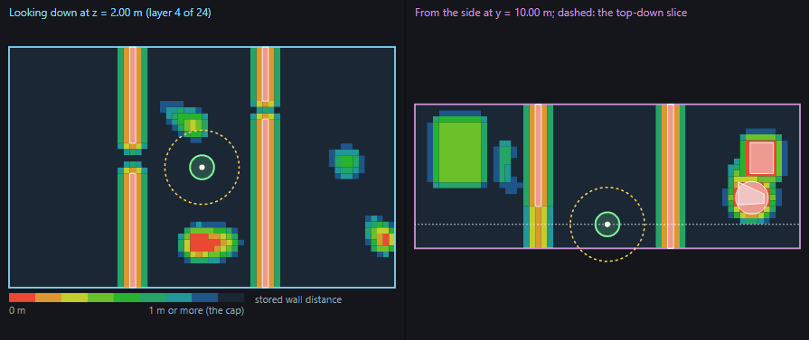
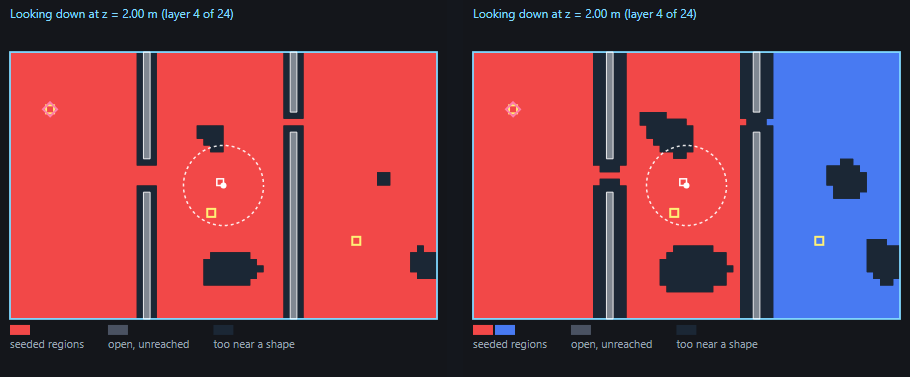
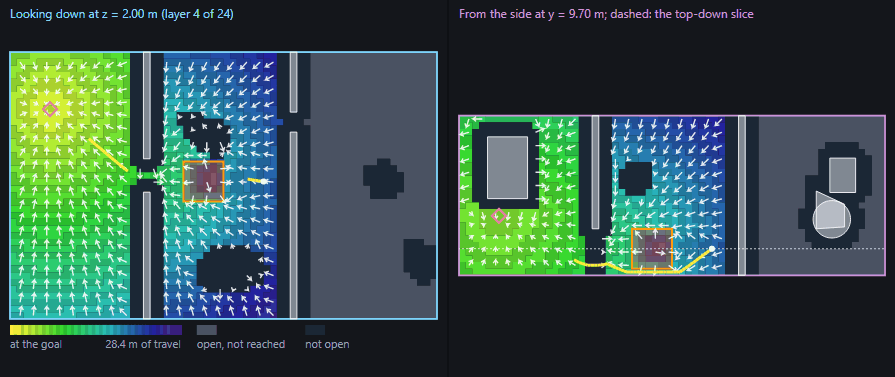
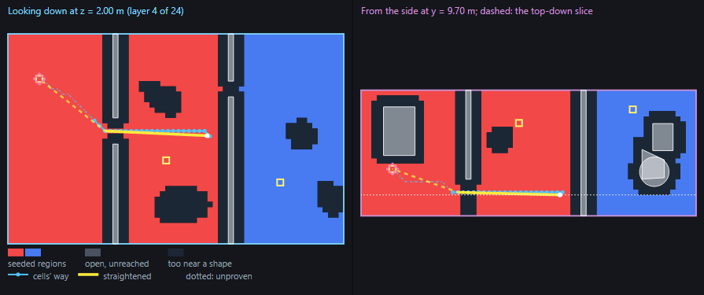
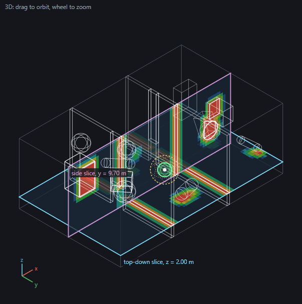

Small .NET libraries for graph algorithms, diffing, saving object graphs and querying boxes in space. They are written to avoid allocating: results go into buffers you provide, and in `Algorithms` the `ref` overloads size the buffers for you.

- **Graphs** (`Algorithms`): strongly connected components with `Graph.Tarjan` (also from chosen roots), `Graph.ConnectedComponents`, and all-pairs shortest paths with `FloydWarshall`.
- **Diffing** (`Algorithms`): `MyersDiff`, `HistogramDiff`, `HeckelDiff` (moved blocks), diffs of items in groups (lines, then the characters in them), `Patch`, and an optional edit budget for all but `HistogramDiff`.
- **Packables** (`Packables`, `Packables.Newtonsoft`): versioned saving and loading of object graphs, with JSON text.
- **Collections**: `TwoWayDictionary`, a dictionary with one-to-one pairs that looks up in both directions.
- **Spatial** (`Spatial`, experimental): the boxes within a radius of a point, and the nearest boxes, by scan or tree. Also, for geometry that does not move, the room at a point, where a body of a given size fits, travel fields to a goal and routes, on a grid. Includes a Unity package.
- **Visualizer**: a desktop and browser app that shows the graph algorithms on random graphs, opens Packables documents, diffs two texts you edit (with moved lines and the characters changed inside lines), and finds boxes near a sphere that follows the pointer in 3D, or a circle in a plane, by scan and by tree, and the distance to fixed shapes on a grid. [Try it in the browser](https://yewnyx.github.io/Algorithms/).

## Graphs

A `Graph` holds only edges. Vertices are plain zero-indexed numbers, so there are no constraints on backing data structures and no unnecessary allocations.

`Graph.Tarjan` writes two layers into spans you provide: `dependencyOrder`, which holds every vertex once, and a list of `Segment`s that slice it into the strongly connected components. The components come out in dependency order: for every edge A → B, B's component is written no later than A's. One pass gives both the components and an order to process them in, with no allocation per component. The search is iterative, with no recursion, each vertex keeping its own cursor into edges held in CSR form, and the output depends only on the vertex count and the set of edges, not on the order they were added.

```csharp
using Yewnyx.Algorithms.Graphs;

// A cycle 0 → 1 → 2 → 0, then a tail 2 → 3 → 4.
var graph = new Graph().AddEdges((0, 1), (1, 2), (2, 0), (2, 3), (3, 4));

int[]? order = null;
Segment[]? segments = null;
int count = graph.Tarjan(ref order, ref segments);   // 3 components
// order:    [4, 3, 2, 1, 0]
// segments: (0, 1) (1, 1) (2, 3)                     (offset, size)

for (int i = 0; i < count; i++) {
    ReadOnlySpan<int> component = order.AsSpan(segments[i]);   // a view, no copy
    // i = 0: [4]   i = 1: [3]   i = 2: [2, 1, 0]
}

// Only what vertex 3 reaches: 2 components, order [4, 3].
count = graph.Tarjan(new[] { 3 }, ref order, ref segments);
```

The `ref` overloads make or grow the arrays; the span overloads write into buffers you own. A `Segment` is an (offset, size) slice of an array: `array.AsSpan(segment)` is a view, and `array[segment]` copies.

- `Graph.ConnectedComponents` groups vertices joined by edges in either direction, using union-find, with groups ordered by their lowest vertex.
- `FloydWarshall.Solve` computes all-pairs shortest paths in place over a caller-owned n × n weight matrix, with an optional next-hop matrix for rebuilding paths. It suits small graphs: O(n³) time.
- `Graph.ContractVersion` is bumped whenever behaviour callers rely on changes, such as output order or buffer rules, so a rebuilt library can't change behaviour silently. Check it once at startup.
- `Graph.AddEdge` and `AddEdges` refuse a negative vertex with `ArgumentOutOfRangeException`, and `AddEdges` adds none of its edges if one is refused.

## Diffing

`MyersDiff` finds a shortest edit script between two sequences, and `HistogramDiff` finds one that lines up the rarest items first, as git's histogram diff does, which reads better for text. Both work over spans, are given their buffers, and don't allocate. A result is a list of `Hunk`s, each saying which range of the original is replaced by which range of the revised.

```csharp
using Yewnyx.Algorithms.Diffing;

string[] original = ["header", "alpha", "beta", "gamma", "footer"];
string[] revised  = ["header", "alpha", "gamma", "delta", "footer"];

// Simple: the arrays are made or replaced as needed.
Hunk[]? hunks = null;
int[]? workspace = null;
int count = MyersDiff.Diff<string>(original, revised, ref hunks, ref workspace);
// hunks[0]: original [2, +1) -> revised [2, +0)   delete "beta"
// hunks[1]: original [4, +0) -> revised [3, +1)   insert "delta" before "footer"

// No allocation: size the buffers with MaxHunks and WorkspaceLength, and keep them.
Span<Hunk> hunkBuffer = stackalloc Hunk[MyersDiff.MaxHunks(original.Length, revised.Length)];
Span<int> work = stackalloc int[MyersDiff.WorkspaceLength(original.Length, revised.Length)];
int spanCount = MyersDiff.Diff<string>(original, revised, hunkBuffer, work); // the same hunks, in hunkBuffer
```

`HistogramDiff` has the same shape and its own `MaxHunks` and `WorkspaceLength`, which are larger. An empty side's offset is where the edit happens. Original and revised may be slices of one buffer, even overlapping ones, because both are only read; hunk offsets are relative to each slice's own start:

```csharp
int[] data = [1, 2, 3, 4, 5, 6, 7, 8, 9, 10, 11, 12, 13];
Hunk[]? sliceHunks = null;
int[]? sliceWorkspace = null;
int sliceCount = MyersDiff.Diff<int>(data.AsSpan(0, 10), data.AsSpan(3, 10), ref sliceHunks, ref sliceWorkspace);
// original [0, +3) -> revised [0, +0)   delete 1, 2, 3
// original [10, +0) -> revised [7, +3)  insert 11, 12, 13
```

A `Patch<T>` keeps a diff for later, without the revised sequence: the hunks and copies of the items they delete and insert. It applies forwards and backwards, and refuses an original that differs in an item the patch deletes:

```csharp
var patch = new Patch<string>();
patch.Set(original, revised, hunks.AsSpan(0, count));
// patch.Deleted: [beta]   patch.Inserted: [delta]

var result = new string[patch.RevisedLength];
patch.TryApply(original, result);   // true: header, alpha, gamma, delta, footer
var undone = new string[patch.OriginalLength];
patch.TryRevert(result, undone);    // true: header, alpha, beta, gamma, footer
```

`FindMoves` pairs deleted items with equal inserted ones:

```csharp
string[] a = ["a", "b", "c", "d"];
string[] b = ["b", "c", "d", "a"];
int moveCount = MyersDiff.Diff<string>(a, b, ref hunks, ref workspace);
patch.Set(a, b, hunks.AsSpan(0, moveCount));
foreach (var (was, now) in patch.FindMoves()) { /* was 0, now 3: "a" moved to the end */ }
```

`FindMoves` pairs single items after the fact. `HeckelDiff` finds whole moved blocks as it diffs. It writes hunks that `Patch<T>` takes unchanged, and the blocks that moved: each pairs a run deleted in one hunk with an equal run inserted in another. A reordered list of distinct items costs O(n log n), where Myers' diff is quadratic. Use it where a move is worth showing: reordered lists, undo, and diff views that draw a moved block instead of a delete and an insert.

```csharp
string[] listBefore = ["Milk", "Eggs", "Bread", "Apples", "Coffee", "Rice"];
string[] listAfter  = ["Coffee", "Milk", "Eggs", "Apples", "Rice", "Bread"];

Hunk[]? listHunks = null;
BlockMove[]? listMoves = null;
int[]? listWorkspace = null;
int listCount = HeckelDiff.Diff<string>(listBefore, listAfter, ref listHunks, ref listMoves, ref listWorkspace, out int listMoveCount);
// 4 hunks: original [0, +0) -> revised [0, +1)   insert Coffee
//          original [2, +1) -> revised [3, +0)   delete Bread
//          original [4, +1) -> revised [4, +0)   delete Coffee
//          original [6, +0) -> revised [5, +1)   insert Bread
// 2 moves: (Original 2, Revised 5, Length 1)     Bread moved to the end
//          (Original 4, Revised 0, Length 1)     Coffee moved to the front
```

`MyersDiff` and `HistogramDiff` give the same four hunks and no moves. Like them, `HeckelDiff` also has span overloads, with `MaxHunks`, `MaxMoves` and `WorkspaceLength`. A block made only of repeated items has no anchor, so it stays a delete and an insert (`FindMoves` can still pair its items one by one), and the script is as short as Myers' only between the blocks that stay.

`GroupClasses` and `GroupedDiff` diff items split into groups, such as the characters of a text split into lines. Use them for text views that show which characters or words changed inside changed lines, and for lists of lists, such as rows of cells. There are three steps, so you pick the diff in the middle: give equal groups one id, diff the ids with `MyersDiff` or `HistogramDiff`, and refine the changed groups into item hunks:

```csharp
using Yewnyx.Algorithms.Graphs;

string textBefore = "one\ntwo\nthree\n";
string textAfter  = "one\ntwo!\nthree\n";
Segment[] linesBefore = [new(0, 4), new(4, 4), new(8, 6)];   // the lines, with their line breaks
Segment[] linesAfter  = [new(0, 4), new(4, 5), new(9, 6)];

// 1. Equal lines share an id, numbered from 0 in the order they are first seen.
int[] idsBefore = new int[linesBefore.Length];
int[] idsAfter = new int[linesAfter.Length];
int[] idWorkspace = new int[GroupClasses.WorkspaceLength(linesBefore.Length, linesAfter.Length)];
GroupClasses.Assign<char>(textBefore, linesBefore, textAfter, linesAfter, idsBefore, idsAfter, idWorkspace);
// idsBefore: [0, 1, 2]   idsAfter: [0, 3, 2]

// 2. Diff the ids, which diffs the lines.
Hunk[]? lineHunks = null;
int[]? lineWorkspace = null;
int lineCount = MyersDiff.Diff<int>(idsBefore, idsAfter, ref lineHunks, ref lineWorkspace);
// original [1, +1) -> revised [1, +1)   the second line changed

// 3. Refine the changed lines into hunks over the characters.
var charHunks = new Hunk[GroupedDiff.MaxHunks(textBefore.Length, textAfter.Length)];
var charWorkspace = new int[GroupedDiff.WorkspaceLength(textBefore.Length, textAfter.Length)];
int charCount = GroupedDiff.Refine<char>(textBefore, linesBefore, textAfter, linesAfter, lineHunks.AsSpan(0, lineCount), charHunks, charWorkspace);
// original [7, +0) -> revised [7, +1)   "!" inserted after "two"
```

The result is one complete script over the items, which `Patch<T>` takes unchanged. Where a run of lines is replaced by as many lines, they pair in order and each pair is diffed with Myers; a run replaced by a different number of lines is one hunk, with nothing refined inside it. The groups must tile the items in order, which for text means lines with their line breaks. You split the text, because the library never parses it, so the items could as well be words in lines or cells in rows. Two long, unrelated lines are diffed quadratically, unless a budget limits it.

An edit budget bounds how hard a diff searches, for callers that diff interactively or inside a frame. `MyersDiff`, `HeckelDiff` and `GroupedDiff.Refine` have overloads taking `int budget, out bool cutShort`; `HistogramDiff` has none, because its cost is in finding anchors, which a budget wouldn't limit. The budget is how many edits (items inserted or deleted) one search looks for, not a limit on the script or on the total work: a script of at most that many edits comes out as it does without one, and past it the search splits at the furthest point it reached, so the script is complete and `Patch<T>` takes it, but it may be longer than the shortest, as `cutShort` tells you. A budget of 0 matches only the common start and end, `int.MaxValue` is no limit, and an odd budget searches as far as the next even one. The time is about `(n + m) * (budget + 7)` item comparisons, where the 7 only matters under 10, so for a total allowance pass `allowance / (n + m) - 7`, but not below 0. `HeckelDiff` budgets its Myers diffs between blocks, not the finding of blocks, and `GroupedDiff.Refine` budgets each pair of lines. Where `HistogramDiff` would be slow, as for many unique items with every second one changed, use `MyersDiff` with a budget.

```csharp
// The shortest script from "AAAABBBB" to "BBBBAAAA" has 8 edits; a budget of 2 cuts the search short.
Hunk[]? budgetHunks = null;
int[]? budgetWorkspace = null;
int budgetCount = MyersDiff.Diff<char>("AAAABBBB", "BBBBAAAA", ref budgetHunks, ref budgetWorkspace, 2, out bool cutShort);
// cutShort is true: original [0, +2) -> revised [0, +4) and original [4, +4) -> revised [6, +2), a valid script of 12 edits.
```

Items must implement `IEquatable<T>`. `HistogramDiff`, `HeckelDiff`, `GroupClasses` and `FindMoves` also hash their items, so `GetHashCode` should agree with `Equals` and vary in its low bits (a struct needs to override it). The inputs may overlap each other, but the workspace and output buffers must not share memory with either one, and `Diff` throws an `ArgumentException` if they do; a `Patch` result must not share memory with its input, and throws if it does.

## Packables

Packables saves a graph of objects to a versioned document and loads it back. Shared and looping references keep their identity, a type's version travels with its data, and a damaged document is reported as problems instead of throwing. Objects write and read themselves, and the library never creates one: you pass a create function or bind an instance you made. `Packables` is the core; `Packables.Newtonsoft` reads and writes the JSON text.

```csharp
using Yewnyx.Packables;

public class Crew : IPackable {
    public string? Name;
    public Crew? Friend;

    public void PackInto(Packer packer) {
        packer.WriteString("name", Name);
        packer.WriteRef("friend", Friend);
    }

    public void UnpackFrom(Unpacker unpacker) {
        unpacker.TryReadString("name", out Name);
        unpacker.TryReadRef("friend", static () => new Crew(), out Friend);
    }
}

var registry = new PackableRegistry.Builder().Add<Crew>("Crew", 0).Build();

// Pack: any object reachable from the root, loops included.
var document = new PackedDocument();
Packer.TryPack(ada, registry, document, out var unregistered);
string json = PackedJson.Write(document, "application/crew+json");

// Read and unpack into a root you provide.
var read = new PackedDocument();
PackedJson.TryRead(json, read, "application/crew+json", out var error);
var problems = new List<UnpackProblem>();
var outcome = Unpacker.Unpack(read, new Crew(), registry, problems); // Clean, WithProblems or Failed
```

A read of an absent key returns false and records nothing. A key of the wrong kind or out of range, or a ref to a missing object or of the wrong type, returns false and is recorded in `problems`. `UnpackOptions.FailFast` ends the load at the first problem, and `Permissive` records unknown types instead of refusing the document.

The JSON for two `Crew` that point at each other, `ada` first (fields sorted by key, objects numbered breadth-first as `"o:N"`):

```json
{
  "Content-Type": "application/crew+json",
  "version": 3,
  "root": { "$ref": "o:0", "$type": "Crew#0" },
  "objects": {
    "o:0": { "$type": "Crew#0", "$fields": { "friend": { "$ref": "o:1", "$type": "Crew#0" }, "name": "Ada" } },
    "o:1": { "$type": "Crew#0", "$fields": { "friend": { "$ref": "o:0", "$type": "Crew#0" }, "name": "Bo" } }
  }
}
```

Plain values are plain JSON, and keys starting with `$` belong to the format: `$ref` with `$type` for a ref, `$map` and `$array` for containers, `$fields` for an object's fields, `{ "$double": "NaN" }` for NaN and the infinities. Ids are opaque strings, so two documents can be joined without renumbering.

To read a format 1 document, register the old assembly-qualified type name as an alias (version 0 is the format 1 layout) and convert it first:

```csharp
var registry = new PackableRegistry.Builder()
    .Add<Crew>("Crew", 0, "Old.Crew, OldAssembly, Version=1.0.0.0, Culture=neutral, PublicKeyToken=null")
    .Build();

var document = new PackedDocument();
if (Format1Converter.TryConvert(oldJson, document, "application/packable+json", registry, out var error)) {
    var outcome = Unpacker.Unpack(document, new Crew(), registry);
}
```

## Spatial

> Experimental: a work in progress that may change, or be removed if it doesn't work out.

`Spatial` finds the boxes within a radius of a point, and the nearest boxes. It's suitable for queries against boxes in which most are still and some move. Non-throwing and zero allocation.

- `BoxScan` is an optimized scan - it's not indexed, but arranges the data in a way that is convenient/optimized to loop over.
- `BoxTree` is an index: it sorts the boxes along a Hilbert curve into a tree, and a query only checks the branches near the point.

Both find the same boxes, and `Nearest` gives identical results, ties included (the lower index comes first).

```csharp
using Yewnyx.Spatial;

// A row of unit cubes at x = 0, 2, 4, 6, 8.
var boxes = new Box[5];
for (int i = 0; i < boxes.Length; i++) { boxes[i] = new Box(2 * i, 0, 0, 2 * i + 1, 1, 1); }

// Scan: pack the boxes into six columns, then query.
var minX = new float[5]; var minY = new float[5]; var minZ = new float[5];
var maxX = new float[5]; var maxY = new float[5]; var maxZ = new float[5];
BoxScan.Pack(boxes, minX, minY, minZ, maxX, maxY, maxZ);
var columns = new BoxColumns(minX, minY, minZ, maxX, maxY, maxZ);

var hits = new int[3];
int found = BoxScan.InSphere(columns, 4.5f, 0.5f, 0.5f, 1.6f, hits, out int total);
// found 3, total 3, hits [1, 2, 3]

var nearest = new int[3];
var distances = new float[3];
int count = BoxScan.Nearest(columns, 4.5f, 0.5f, 0.5f, 100f, nearest, distances);   // 100f: the limit, as a squared distance
// count 3, nearest [2, 1, 3], distances [0, 2.25, 2.25]   (squared distances, nearest first)

// Tree: build over the region the boxes lie in, then query.
var nodes = new BoxNode[BoxTree.NodesLength(boxes.Length)];
var order = new int[boxes.Length];
var workspace = new int[BoxTree.WorkspaceLength(boxes.Length)];
bool built = BoxTree.Build(boxes, new Box(0, 0, 0, 10, 1, 1), nodes, order, workspace, out int nodeCount);
// built true

var tree = nodes.AsSpan(0, nodeCount);
found = BoxTree.InSphere(tree, order, boxes, 4.5f, 0.5f, 0.5f, 1.6f, hits, out total);
// found 3, total 3: boxes 1, 2 and 3 (in tree order)
count = BoxTree.Nearest(tree, order, boxes, 4.5f, 0.5f, 0.5f, 100f, nearest, distances);
// count 3, nearest [2, 1, 3], distances [0, 2.25, 2.25]   (the scan's results)
```

- A query returns how many results it wrote (at most the buffer's length). `total` is how many matched.
- A query returns -1 if it can tell its spans don't belong together (columns of different lengths, `order` and `boxes` of different lengths, or nodes that don't fit them). Then read nothing from its outputs. `Build` returns false, writing nothing, if a buffer is too short.
- Cut the columns and `order` to the number of boxes, and `nodes` to `nodeCount`. A box outside the `extent` given to `Build` is still found, but queries may be slower.
- A box that touches the sphere matches. A NaN coordinate leaves that side of the box open (unlimited). A negative or NaN radius, or a NaN point, matches nothing.

### Room, fit and routes on a grid

For callers that ask "how much room is there here?" of geometry that doesn't move, many times a frame. A grid over the shapes answers four questions, each built on the one before:

| Layer | It answers | Calls | Memory |
|---|---|---|---|
| Room | How far is the nearest shape from this point? | `Shapes.Distance` (exact), `WallDistance.RoomAt` (from the grid), `WallTrees.RoomAt` (from a tree) | 1 byte a cell, or with a tree only near surfaces |
| Fit | Can a body of this radius be here? Which cells can it reach? | `SizeClass.TryMake`, `Regions.FromSeeds`, `Regions.IsOpen`, `Regions.NearestOpen`; over a tree `TreeRegions` | 1 byte a cell for each body size; over a tree a byte a brick and a byte an open cube |
| Travel field | How far is each cell from a goal, going round what is in the way, and which way is down? | `Travel.Build`, `Travel.Sample` | 2 bytes a cell, for each field |
| Route | A few straight legs from here to there | `Routes.Find`; over a tree `TreeRoutes.Find` | 16 bytes a cell, for the search's arrays; over a tree 28 bytes a slot, sized to the search |

`CellCost` is one more byte a cell that you write: 0 is normal, 255 is closed, and anything else makes a cell cost more to cross. `Shapes` holds what nothing may pass through (boxes at any angle, spheres, capsules, triangles and heightfields, with a `BoxTree` over them), and `Shapes.Write` stores them as one block of bytes, so a tool can read meshes once and ship the block. `HeightFields.Pack` makes a heightfield from a grid of heights: ground that is solid from its surface down. It keeps every 8th, 4th or 2nd height where that stays within a bound of the ground, and every height where it does not.

The samples below run one after another, in a room of 8 x 8 x 4 m.

#### Room at a point



*The Visualizer's Spatial grid tab, coloured by wall distance. The dashed circle is the exact distance from the probe to the nearest shape, and the green circle is the room the grid alone proves.*

`Shapes.Distance` is exact. `WallDistance.RoomAt` reads eight cells of the grid and gives a distance the nearest shape is proven to be at least.

```csharp
using Yewnyx.Spatial;

// A floor, a pillar and one slanted triangle.
Solid[] solids = { Solid.Box(new Box(0, 0, -1, 8, 8, 0)), Solid.Capsule(4, 4, 0, 4, 4, 4, 0.25f) };
float[] corners = { 0, 6, 0,   8, 6, 0,   4, 8, 3 };
int[] triangles = { 0, 1, 2 };   // one triangle: corners 0, 1 and 2

// Store them as one block, then view the block as shapes.
var block = new byte[Shapes.BlockLength(solids.Length, corners.Length / 3, triangles.Length / 3)];
Shapes.Write(solids, corners, triangles, new int[Shapes.WorkspaceLength(3)], block, out int length);
Shapes.TryRead(block.AsSpan(0, length), out ShapeSet shapes);

Shapes.Distance(shapes, 2f, 4f, 1f, limit: 5f, out float exact);
// exact 1: the floor is nearest
```

A grid of half-metre cells over the room is filled one z layer at a time (layers can run side by side):

```csharp
var grid = new GridShape(0, 0, 0, 0.5f, 16, 16, 8);
var map = new byte[grid.CellCount];
for (int layer = 0; layer < grid.CountZ; layer++) {
    WallDistance.MarkLayer(grid, shapes, unit: 1f / 128f, cap: 128, layer, map.AsSpan(layer * grid.LayerLength, grid.LayerLength));
}

var wall = new WallMap(grid, 1f / 128f, 128, map);
WallDistance.RoomAt(wall, 2f, 4f, 1f, out float room);
// room 0.90: proven from the eight cells around the point, and never more than the exact 1
```

#### Cost

A cost of c makes a cell 1 + c / 16 times as far to cross, so 32 is three times. Cells whose centre is inside the solid you fill get the cost.

```csharp
var cost = new byte[grid.CellCount];
CellCost.Fill(grid, Solid.Box(new Box(0, 0, 0, 2, 2, 4)), 32, cost);
CellCost.At(grid, cost, 1f, 1f, 1f, out byte value);
// value 32
```

#### Where a body fits



*Left: a body of radius 0.6 m, and the whole floor is one region. Right: radius 0.9 m, where the narrow doorway is too tight, so the room beyond it is a second region (blue).*

A size class is what a body of one radius needs of the grid. `Regions.FromSeeds` floods the cells that body can be in, from seeds such as the openings into a room.

```csharp
SizeClass.TryMake(0.6f, wall, out SizeClass size);
var region = new byte[grid.CellCount];
Solid[] seeds = { Solid.Sphere(2, 2, 2, 0.5f) };
Regions.FromSeeds(wall, size, cost, seeds, region, new int[Regions.QueueLength(grid)], out int reached, out int empty);
// reached 1586 cells; empty 0: the seed held an open cell

bool open = Regions.IsOpen(grid, region, 2f, 4f, 2f);          // true
bool low = Regions.IsOpen(grid, region, 2f, 4f, 0.3f);         // false: too near the floor
Regions.NearestOpen(grid, region, 2f, 4f, 0.1f, reach: 2f, out float x, out float y, out float z);
// 1.75, 3.75, 0.75: the centre of the nearest open cell, up off the floor
```

#### A travel field to a goal



*A travel field with a costly box (orange) dropped in the way. The yellow line is the path the field leads the probe along; in the side view it dips under the box, which is only 3 m tall, because that is cheaper than going round.*

For bodies with no plan of their own: one field per goal, and any number of followers ask it which way to go.

```csharp
// How far every open cell is from a goal at 6, 6, 2, in centimetres, through the cells that body can be in.
var field = new ushort[grid.CellCount];
TravelSeed[] goal = { TravelSeed.FromPoint(Solid.Sphere(6, 6, 2, 0.8f), 6, 6, 2) };
Travel.Build(grid, region, cost, goal, unit: 0.01f, field, new float[Travel.TimesLength(grid)], new int[Travel.HeapLength(grid)],
    out int covered, out int cut);
// covered 1586: every cell the flood reached; cut 0

Travel.Sample(new TravelField(grid, 0.01f, field), 2f, 2f, 2f, out float wayX, out float wayY, out float wayZ, out float travel);
// travel 6.91 m: the straight line is 5.66, but the pillar stands in it and the costly corner is beside it
// way 0.71, 0.71, 0: the direction that leads down the field from here
```

#### A route



*A route from the white dot (the start) to the pink diamond (the goal). The dotted blue line is the way the search stepped through the cells, with a dot at each cell centre, and the yellow line is the same way pulled straight into a few legs. The last legs, into the diamond, are thin and dashed because the goal lies off both slices: a leg that leaves a slice is drawn flattened onto it.*

The way for one body from a point to a goal, as a few straight legs, each proven clear for the body's full radius. The arrays are the search's own.

```csharp
var points = new float[3 * 16];
RouteResult route = Routes.Find(wall, size, shapes, region, cost, 2f, 2f, 2f, 6f, 6f, 2f, straighten: true,
    new float[Routes.SumsLength(grid)], new int[Routes.LinksLength(grid)], new int[Routes.HeapLength(grid)], points);
// route.Status Found, route.Count 2: to 5.75, 3.75, 2.25, which clears the pillar, and from there to 6, 6, 2
```

#### In 3D



*The same grid in the Visualizer's 3D view, with the wall distance on two slices.*

The Visualizer's Spatial grid tab shows these layers in slices and in 3D.

#### What to know

- Queries take and return points, never cell numbers. `GridShape.TryCentre` gives the centre of the cell that holds a point.
- Every call returns false if it is refused (a point outside the grid, spans that don't belong together, a shape that may not be stored). Then read nothing from its outputs.
- A triangle has no inside, so the middle of a closed shell of triangles reads as room. A solid's inside reads 0.
- "Open" is said of cells: `IsOpen` at a point says its cell is open. To ask whether a body fits at a point, compare `RoomAt` or `Shapes.Distance` with its radius.
- A route is the points to go to in turn; the start isn't among them. Read `RouteResult.Status` first.

The rest, one line each and grouped by type, is in [Spatial/Reference.md](Spatial/Reference.md).

`Spatial.Unity/` is a Unity package (`xyz.yewnyx.spatial`) around the same source. For boxes it has a `BoxSet` that recomputes only the boxes that moved, Burst jobs that rebuild the tree and answer batches of queries, a gizmo and a sample scene. For the grid it has a `WallGrid` that is marked, flooded and searched in jobs, `ColliderShapes` to fill it from colliders (a part of a larger level at a time, with terrains as heightfields), travel fields and routes. To install it, download the `.tgz` of a release from the repository's Releases page and add it in Unity with Package Manager's **Add package from tarball**. See [Spatial.Unity/README.md](Spatial.Unity/README.md) and its [reference](Spatial.Unity/Documentation~/Reference.md).
