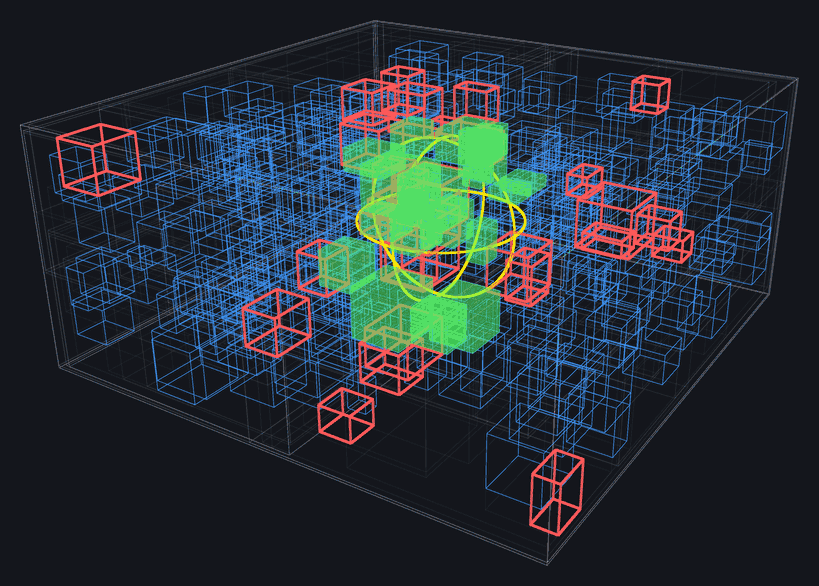
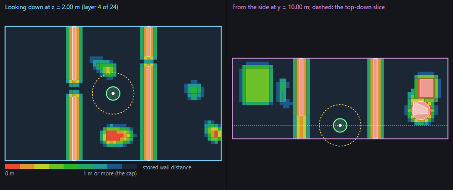
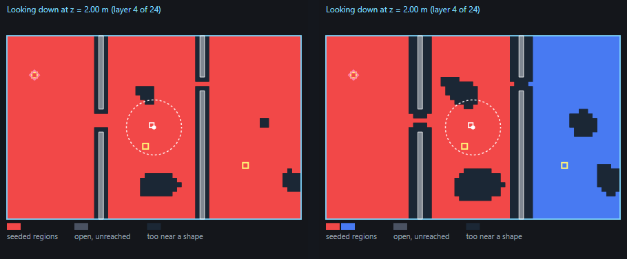
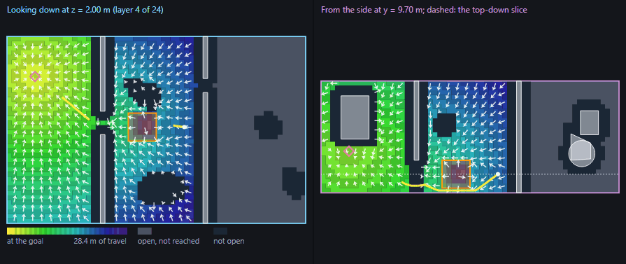
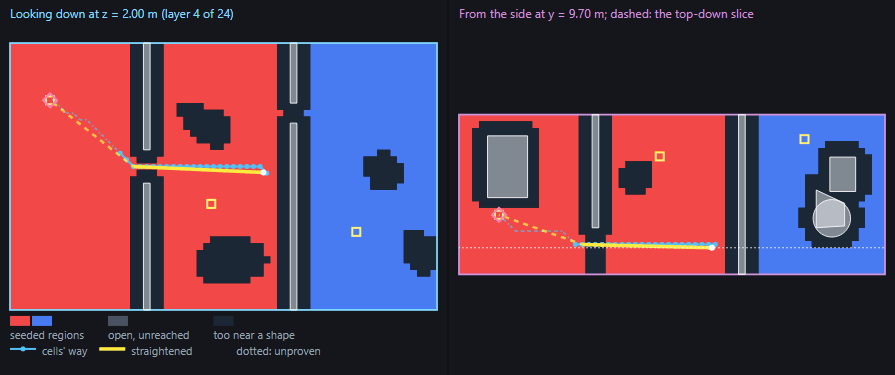
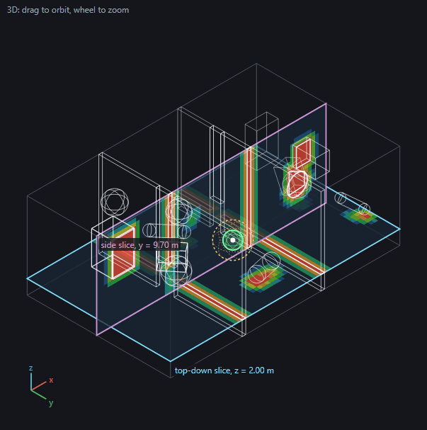

# Spatial for Unity

> Experimental: a work in progress that may change, or be removed if it doesn't work out.

Fast questions about space, asked from jobs: which boxes are near a point, how much room there is at a point, where a body of a given size fits, and the way from here to there. Built for callers that ask many times a frame, over things that mostly stay put.

## Install

1. Download `xyz.yewnyx.spatial-<version>.tgz` from the repository's Releases page.
2. In Unity: **Window > Package Manager > + > Add package from tarball**, and pick the file.

| Needs | Version |
|---|---|
| Unity | 6000.3 |
| Burst | 1.8.29 |
| Collections | 2.6.5 |
| Mathematics | 1.3.3 |
| Physics module (built in) | 1.0.0 |
| Terrain module (built in) | 1.0.0 |
| Terrain Physics module (built in) | 1.0.0 |

Package Manager brings in the packages. These are the versions it was tested with; nothing older has been tried.

## Boxes near a point



*The Moving boxes sample, drawn with the gizmo's colours: blue boxes rest, red were just moved, green were found by the query (the yellow rings), and the faint boxes are the tree. An illustration made from the sample's data, not a scene view capture.*

A `BoxSet` holds up to a fixed number of boxes (each with an id you choose) and answers two questions in jobs: which boxes are within a radius of a point, and which are nearest. Boxes that rest cost nothing; only the ones you move are worked out again.

Make the set and add items. An item is a box in its own frame (a centre and half-extents) at a pose:

```csharp
// Up to 1,000 items somewhere in a 200 m cube.
var set = new BoxSet(1000, new Box(-100, -100, -100, 100, 100, 100));
set.Add(id: 7, centre: float3.zero, halfExtents: new float3(0.5f), position, rotation);
```

Each frame, say what moved, then schedule the update:

```csharp
set.Move(7, newPosition, newRotation);
JobHandle upToDate = set.Schedule();
```

Then ask. One sphere per query: x, y, z and the radius in w.

```csharp
var spheres = new NativeArray<float4>(1, Allocator.TempJob);
var results = new NativeArray<int>(16, Allocator.TempJob);      // room for 16 ids per query
var counts = new NativeArray<int>(1, Allocator.TempJob);
var totals = new NativeArray<int>(1, Allocator.TempJob);
spheres[0] = new float4(point, 4f);
JobHandle done = set.ScheduleInSphere(spheres, results, counts, totals, stride: 16, tree: true);
done.Complete();   // results[0 .. counts[0]) are the ids found
```

`ScheduleNearest` has the same shape and also writes the squared distances, nearest first. `tree: false` tests every box instead of walking the tree. When many items move every frame, hand their poses over in arrays: see [Moving many items](Documentation~/Reference.md#moving-many-items).

The same boxes in the Visualizer, with the radius hits and the five nearest:


*The same idea in the Visualizer's Boxes tab: white boxes are the radius hits, the numbers 1 to 5 are the nearest, and the yellow outlines are the tree nodes the walk visited.*

## Room, fit and routes on a grid

For geometry that does not move: a grid over it answers four questions, each built on the one before.

| Layer | It answers | Calls | Memory |
|---|---|---|---|
| Room | How far is the nearest wall from this point? | `TryRoom`, `TryDistance` | 1 byte a cell |
| Fit | Can a body of this radius be here? Where is the nearest place it can be? | `AddSizeClass`, `ScheduleRegions`, `IsOpen`, `TryNearestOpen` | 1 byte a cell for each body size |
| Travel field | How far is each cell from a goal, going round what is in the way, and which way is down? | `ScheduleField`, `TrySample` | 2 bytes a cell, for each field |
| Route | A few straight legs from here to there | `WallGridRoute.Schedule` | 16 bytes a cell of the largest grid, for each route object |

All of it is in the grid's own frame, which has no transform: where it sits in the world is up to you.

### Build the grid

Turn colliders into shapes, hand them to a grid, and have it work out every cell's distance to the nearest shape:

```csharp
var grid = new WallGrid(new GridShape(0, 0, 0, 0.5f, 80, 80, 60));   // half-metre cells, 40 x 40 x 30 m
ColliderShapes.TryWrite(colliders, root.worldToLocalMatrix, out byte[] block, out CollectReport report);
grid.SetShapes(block);        // copies them, so the block can go
grid.ScheduleMark();          // each cell's distance to the nearest shape, in jobs
```

Do this in the editor and store the block: a built player cannot read most meshes. `SetShapes` takes the stored block back.

For a part of a larger level, collect only what reaches into the grid's box. Terrains then go in as heightfields: solid from their surface down, so the space under the ground never reads as room.

```csharp
ColliderShapes.TryWrite(colliders, root.worldToLocalMatrix, ColliderShapes.Within(grid.Shape, grid.Unit, grid.Cap), out block, out report);
```

### Room at a point



*The Visualizer's Spatial grid tab, coloured by wall distance. The dashed circle is the exact distance from the probe to the nearest shape, and the green circle is the room the grid alone proves.*

`TryRoom` is quick (it reads eight cells) and never claims more than the true distance. `TryDistance` is exact, from the shapes, up to a limit you give.

```csharp
grid.TryRoom(point, out float room);                  // at least this far from every shape
grid.TryDistance(point, limit: 1f, out float exact);  // exactly this far, or 1 if nothing is nearer
```

### Where a body fits



*Left: a body of radius 0.6 m, and the whole floor is one region. Right: radius 0.9 m, where the narrow doorway is too tight, so the room beyond it is a second region (blue).*

Add a size of body, then flood from seeds, such as the openings into a room. Cells a body of that size can be in and reach from a seed become its regions. A door can be shut with a cost: every cell whose centre is inside the box you fill is closed.

```csharp
const float radius = 0.6f;                                  // the body's radius, in metres
grid.FillCost(Solid.Box(new Box(4 - radius, 6 - radius, 0, 5 + radius, 6.5f + radius, 2.2f)), CellCost.Closed);   // shut a doorway, with the radius to spare
int body = grid.AddSizeClass(radius);
grid.ScheduleRegions(body, seeds);                          // after ScheduleMark
grid.IsOpen(body, point);                                   // can a body be at this cell?
grid.TryNearestOpen(body, point, reach: 2f, out float3 open);                // the nearest place it can be
grid.TryNearestOpen(body, point, reach: 2f, like: from, out open);           // ... that can be reached from another point
```

### A travel field to a goal



*A travel field with a costly box (orange) dropped in the way. The yellow line is the path the field leads the probe along; in the side view it dips under the box, which is only 3 m tall, because that is cheaper than going round.*

For followers with no plan of their own: build one field per goal, then ask it, for each follower, which way to go.

```csharp
var toGoal = new[] { TravelSeed.FromPoint(Solid.Sphere(goal.x, goal.y, goal.z, 0.8f), goal.x, goal.y, goal.z) };
WallGridField field = grid.ScheduleField(body, toGoal);
field.TrySample(point, out float3 way, out float left);   // the way down the field, and how far is left
```

`ScheduleSample` asks for many points at once, in a job. Dispose the field when you are done with it.

### A route



*A route from the white dot (the start) to the pink diamond (the goal). The dotted blue line is the way the search stepped through the cells, with a dot at each cell centre, and the yellow line is the same way pulled straight into a few legs. The last legs, into the diamond, are thin and dashed because the goal lies off both slices: a leg that leaves a slice is drawn flattened onto it.*

The way for one body from one point to another, as a few straight legs.

```csharp
var route = new WallGridRoute();            // keep it: it holds the search's arrays
route.Schedule(grid, body, from, to);       // searched in a job
if (route.Status == RouteStatus.Found) {    // reading the answer waits for the job
    NativeArray<float3>.ReadOnly legs = route.Points;   // go to each in turn; the last is the goal
}
```

### In 3D



*The same grid in the Visualizer's 3D view, with the wall distance on two slices.*

The Visualizer's Spatial grid tab shows these layers in slices and in 3D.

## Seeing it in Unity

- `BoxSetGizmo` draws a set in the scene view (`gizmo.Set = set`): each item's box, blue if it rested and red if the last `Schedule` worked it out again, and the tree's nodes, fainter the deeper they are. It waits for the set's jobs, so use it for looking, not in a build that must be quick.
- The sample **Moving boxes** (Package Manager, Samples): 300 boxes, a tenth drifting, and a query that follows an object you drag. Boxes it finds turn green.

## Five rules that bite

1. **The frame is the grid's own.** Points and shapes are in the grid's frame; it holds no transform.
2. **Bake the block in the editor.** A built player cannot read a mesh unless it was imported with Read/Write on.
3. **Mark before you flood.** A flood is refused unless the wall distance was marked from the shapes the grid holds. Flood again after `SetShapes`, `FillCost` or `ClearCost`.
4. **Dispose what you own:** the `BoxSet`, the `WallGrid`, each `WallGridField` and each `WallGridRoute`.
5. **A field outlives its grid but cannot know the way has changed.** If a door shuts or a cost changes, dispose the field and build a new one.

## More

- [Reference.md](Documentation~/Reference.md): every rule and limit, one line each, grouped by type.
- The package has two folders. `Runtime/` holds the Unity parts (`BoxSet`, the jobs, `WallGrid`, `ColliderShapes`). `Core/` is the Spatial library with no Unity reference, which also builds for .NET and is described in the [repository README](https://github.com/yewnyx/Algorithms/blob/spatial/README.md#spatial).
- Tests run in the Unity editor, with the package in a project's `testables`; see the [reference](Documentation~/Reference.md#tests).
